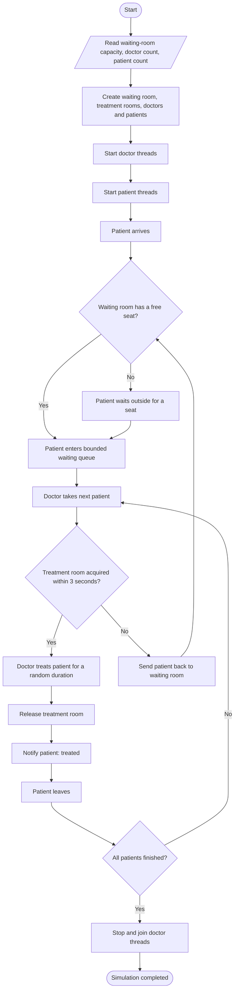

# Hospital Emergency Room Simulation

A Java multithreaded simulation of a hospital emergency room. Patients arrive, wait for a seat, are assigned to doctors, and receive treatment when one of the two treatment rooms is available.

## Project structure

```text
Hospital Emergency Room
│
├── Hospital.java          # Entry point; reads input and starts/stops threads
├── Patient.java           # Patient thread and treatment outcome handling
├── Doctor.java            # Doctor thread; takes patients and treats them
├── WaitingRoom.java       # Bounded buffer shared by patients and doctors
├── TreatmentRooms.java    # Controls access to the two treatment rooms
├── Semaphore.java        # Custom counting semaphore with timed acquire
├── Logger.java            # Synchronized console output
└── WaitingRoomTest.java   # Basic synchronization tests
```

## High-level workflow



## How synchronization works

- **Waiting room (bounded buffer):** `emptySlots` limits the number of patients in the queue, `availablePatients` signals that a patient can be taken, and `mutex` protects queue operations.
- **Producer–Consumer:** patient threads produce queue entries; doctor threads consume them.
- **Treatment rooms:** a separate semaphore starts with two permits, so at most two doctors can treat patients at the same time.
- **Timed acquisition:** a doctor waits up to three seconds for a treatment-room permit. If it cannot acquire one, the patient is sent back to the waiting room.
- **Patient outcome:** each patient waits on a private signal until the doctor reports either treatment completion or a return to the queue.
- **Logging:** `Logger.log()` is synchronized to keep each printed message together.

## Requirements

- Java JDK 8 or newer.
- No external libraries are required.
- All Java source files should be in the `hospital` package and stored in a directory named `hospital`.

## Compile and run

From the directory that contains the `hospital` folder:

```bash
javac hospital/*.java
java hospital.Hospital
```

The program asks for:

1. Waiting room capacity
2. Number of doctors
3. Number of patients

Enter a positive whole number for each value.

## Run the synchronization tests

```bash
java hospital.WaitingRoomTest
```

The test program exercises the custom semaphore, treatment-room capacity, and a basic waiting-room producer–consumer interaction.


## Example run

The following is an example of a real run using:

- Waiting room capacity: `1`
- Number of doctors: `5`
- Number of patients: `8`

> **Important:** Because the program uses multiple threads, the order of events can change between runs. Your output may not be identical, but the same kinds of events should appear.

### Sample console output

```text
Waiting room capacity: 1
Number of doctors: 5
Number of patients: 8
Patients arriving:
P1 P2 P3 P4 P5 P6 P7 P8
P1 arrived.
P7 arrived.
P8 arrived.
P2 arrived.
P6 arrived.
P3 arrived.
The waiting room is full.
P5 arrived.
P8 entered the waiting room.
P1 entered the waiting room.
P2 entered the waiting room.
P6 entered the waiting room.
P4 arrived.
The waiting room is full.
P4 is waiting outside for an available seat.
P3 entered the waiting room.
P7 is waiting outside for an available seat.
P5 entered the waiting room.
Doctor 5 is assigned to P3.
Doctor 3 is assigned to P8.
Doctor 3 is trying to acquire a treatment room.
Doctor 4 is assigned to P6.
Doctor 4 is trying to acquire a treatment room.
Doctor 2 is assigned to P2.
Doctor 5 is trying to acquire a treatment room.
Doctor 1 is assigned to P1.
Doctor 1 is trying to acquire a treatment room.
Doctor 3 acquired a treatment room.
Doctor 4 acquired a treatment room.
Doctor 4 begins treating P6.
Doctor 3 begins treating P8.
Doctor 3 finished treating P8.
Doctor 5 acquired a treatment room.
Doctor 3 released the treatment room.
Doctor 5 begins treating P3.
P8 left.
Doctor 3 is now available.
Doctor 3 is assigned to P5.
P4 entered the waiting room.
Doctor 3 is trying to acquire a treatment room.
Doctor 5 finished treating P3.
Doctor 5 released the treatment room.
Doctor 1 acquired a treatment room.
Doctor 1 begins treating P1.
Doctor 5 is now available.
Doctor 5 is assigned to P4.
P3 left.
P7 entered the waiting room.
Doctor 5 is trying to acquire a treatment room.
Doctor 2 could not acquire a treatment room.
Doctor 2 is sending P2 back to the waiting room.
Doctor 2 is now available.
The waiting room is full.
Doctor 2 is assigned to P7.
P2 is waiting outside for an available seat.
P2 entered the waiting room.
Doctor 2 is trying to acquire a treatment room.
Doctor 4 finished treating P6.
Doctor 4 released the treatment room.
Doctor 3 acquired a treatment room.
Doctor 4 is now available.
P6 left.
Doctor 3 begins treating P5.
Doctor 4 is assigned to P2.
Doctor 4 is trying to acquire a treatment room.
Doctor 5 could not acquire a treatment room.
Doctor 5 is sending P4 back to the waiting room.
Doctor 5 is now available.
P4 entered the waiting room.
Doctor 5 is assigned to P4.
Doctor 5 is trying to acquire a treatment room.
Doctor 2 could not acquire a treatment room.
Doctor 2 is sending P7 back to the waiting room.
Doctor 2 is now available.
P7 entered the waiting room.
Doctor 2 is assigned to P7.
Doctor 2 is trying to acquire a treatment room.
Doctor 1 finished treating P1.
Doctor 1 released the treatment room.
Doctor 4 acquired a treatment room.
Doctor 1 is now available.
P1 left.
Doctor 4 begins treating P2.
Doctor 3 finished treating P5.
Doctor 3 released the treatment room.
Doctor 5 acquired a treatment room.
Doctor 3 is now available.
P5 left.
Doctor 5 begins treating P4.
Doctor 2 could not acquire a treatment room.
Doctor 2 is sending P7 back to the waiting room.
Doctor 2 is now available.
P7 entered the waiting room.
Doctor 1 is assigned to P7.
Doctor 1 is trying to acquire a treatment room.
Doctor 4 finished treating P2.
Doctor 1 acquired a treatment room.
Doctor 4 released the treatment room.
Doctor 1 begins treating P7.
Doctor 4 is now available.
P2 left.
Doctor 5 finished treating P4.
Doctor 5 released the treatment room.
Doctor 5 is now available.
P4 left.
Doctor 1 finished treating P7.
Doctor 1 released the treatment room.
Doctor 1 is now available.
P7 left.
All patients have been treated.
Simulation completed.
```

### Understanding the output, step by step

| Output message | Meaning |
|---|---|
| `Waiting room capacity: 1` | The waiting room can hold only one patient at a time. |
| `Number of doctors: 5` | Five doctor threads are created. |
| `Number of patients: 8` | Eight patient threads are created. |
| `Patients arriving:` | The program prints the identifiers of all patients. |
| `P1 arrived.` | Patient P1 has arrived at the hospital. The arrival order is controlled by thread scheduling, so it may vary. |
| `The waiting room is full.` | A patient tried to enter when the waiting-room capacity was already occupied. |
| `P4 is waiting outside for an available seat.` | The patient is blocked until a waiting-room seat becomes free. |
| `P8 entered the waiting room.` | The patient successfully added themselves to the waiting queue. |
| `Doctor 3 is assigned to P8.` | A doctor removed the next available patient from the queue. |
| `Doctor 3 is trying to acquire a treatment room.` | The doctor starts the timed attempt to obtain one of the two treatment rooms. |
| `Doctor 3 acquired a treatment room.` | A treatment-room permit was successfully acquired. |
| `Doctor 3 begins treating P8.` | Treatment starts. The simulation sleeps for a random duration. |
| `Doctor 3 finished treating P8.` | The simulated treatment is complete. |
| `Doctor 3 released the treatment room.` | The doctor releases the permit so another doctor can use the room. |
| `P8 left.` | The patient was notified that treatment succeeded and leaves the hospital. |
| `Doctor 2 could not acquire a treatment room.` | The doctor did not obtain a room within the three-second timeout. |
| `Doctor 2 is sending P2 back to the waiting room.` | The doctor reports the unsuccessful attempt to the patient, who will try to enter the waiting room again. |
| `Doctor 2 is now available.` | The doctor has completed the current attempt and can take another patient. |
| `All patients have been treated.` | The main thread has waited for every patient thread to finish. |
| `Simulation completed.` | The simulation has ended. |

### What this run demonstrates

1. **Bounded waiting room:** With capacity `1`, patients cannot all enter at once. Some wait outside until a seat is released.
2. **Concurrent doctors:** Multiple doctors can take patients and attempt to acquire rooms concurrently.
3. **Two treatment rooms:** No more than two doctors can hold treatment-room permits at the same time.
4. **Three-second timeout:** A doctor that cannot acquire a room within the timeout sends the patient back to the waiting room.
5. **Patient retry:** A returned patient waits for a seat and re-enters the queue to be treated again.
6. **Completion:** All eight patients eventually receive treatment and leave in this example run.


## Notes

- The simulation uses concurrent threads, so the order of console messages can differ between runs.
- The waiting room capacity and number of doctors/patients are entered at runtime.
- The treatment-room count is fixed at **two**, and the room-acquisition timeout is **three seconds**.
